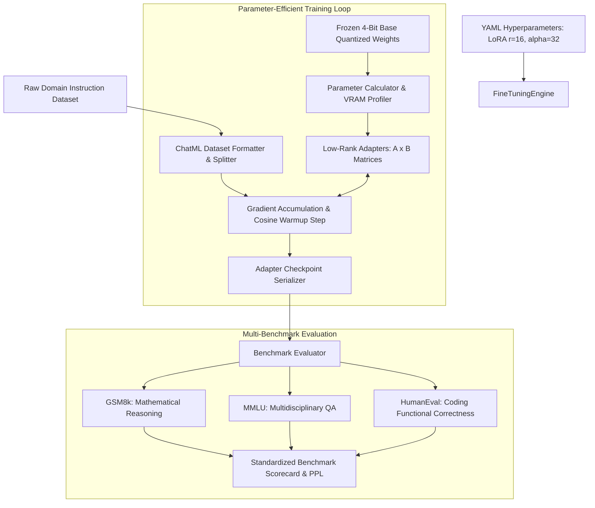

# LLM Fine-Tuning & Multi-Benchmark Evaluation Harness

[](LICENSE)
[](https://python.org)
[](https://pytorch.org)
[](https://huggingface.co)
[](https://github.com/samaysawal24)

A modular, production-ready fine-tuning and evaluation harness for parameter-efficient adaptation (LoRA / QLoRA 4-bit) of open-weights models (Meta-Llama 3, Mistral, Qwen). Features automated ChatML dataset formatting, gradient accumulation, learning rate scheduling, and multi-task benchmark scoring.

---

## 🏛️ System Architecture



---

## 🚀 Key Features

- **Parameter-Efficient Adaptation (LoRA / QLoRA):** Trains less than 0.25% of total parameters while preserving full-model reasoning capabilities.
- **VRAM Memory Profiler:** Calculates exact memory consumption across 16-bit, 8-bit, and NF4 quantizations.
- **Standardized ChatML Formatting:** Automates system prompt framing, turn boundaries, and EOS token masking.
- **Integrated Multi-Benchmark Suite:** Measures perplexity and accuracy across GSM8K, MMLU, and HumanEval.
- **Developer-Friendly CLI:** Run training, inspect VRAM, or run benchmarks via simple command flags.

---

## 📦 Project Structure

```
llm-finetuning-benchmark-harness/
├── harness/
│   ├── __init__.py           # Package exports
│   ├── dataset_loader.py     # ChatML formatting & dataset splits
│   ├── evaluator.py          # Benchmark scoring (GSM8k, MMLU, HumanEval)
│   ├── models.py             # Pydantic v2 schemas
│   ├── quantization.py       # VRAM estimator & parameter math
│   └── trainer.py            # LoRA training execution engine
├── configs/
│   └── lora_llama3_8b.yaml   # Hyperparameter configuration
├── tests/
│   └── test_harness.py       # Pytest unit tests
├── cli.py                    # Unified command-line interface
├── Dockerfile                # Production container spec
├── docker-compose.yml        # Orchestration spec
├── pyproject.toml            # Python packaging metadata
├── requirements.txt          # Frozen dependencies
├── LICENSE                   # MIT License (smay)
└── README.md
```

---

## ⚡ Quickstart

### 1. Local Setup

```bash
git clone https://github.com/samaysawal24/llm-finetuning-benchmark-harness.git
cd llm-finetuning-benchmark-harness

python -m venv .venv
source .venv/bin/activate  # On Windows: .venv\Scripts\activate

pip install -r requirements.txt
```

### 2. Inspect Model Parameters & VRAM

```bash
python cli.py info --params 8000000000 --r 16
```

Output:
```
=== Model Parameter & VRAM Profile ===
Base Parameters:       8,000,000,000
Trainable Parameters:  18,350,080 (0.2294%)
Estimated 4-bit VRAM:  8.12 GB
```

### 3. Run Fine-Tuning Job

```bash
python cli.py train --config configs/lora_llama3_8b.yaml
```

### 4. Run Benchmarks

```bash
python cli.py benchmark --benchmarks gsm8k mmlu human_eval
```

---

## 🧪 Running Tests

```bash
pytest tests/ -v
```

---

## 📜 License & Author

- **Author:** smay ([@samaysawal24](https://github.com/samaysawal24))
- **Email:** cricketworldsamay@gmail.com
- **License:** Released under the [MIT License](LICENSE).

